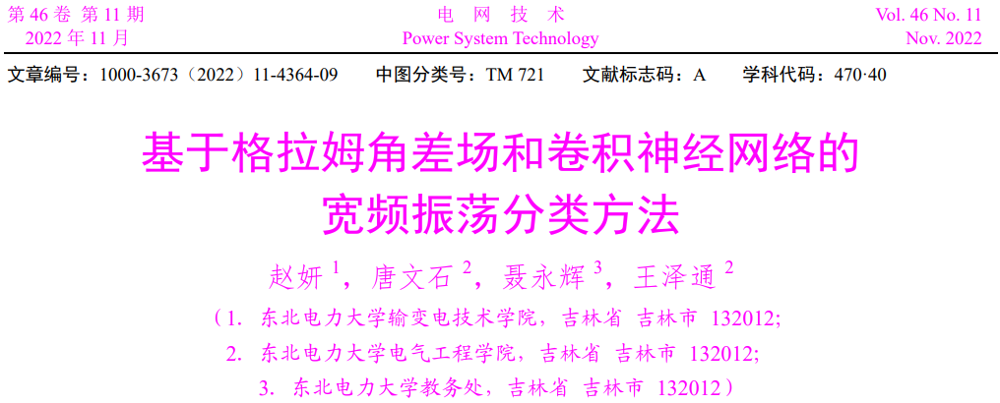
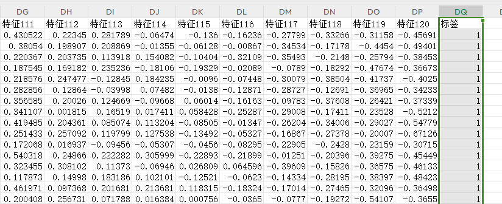
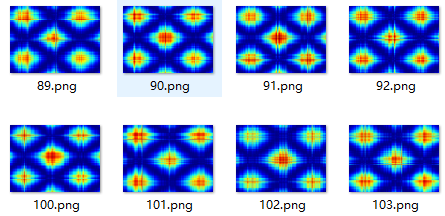
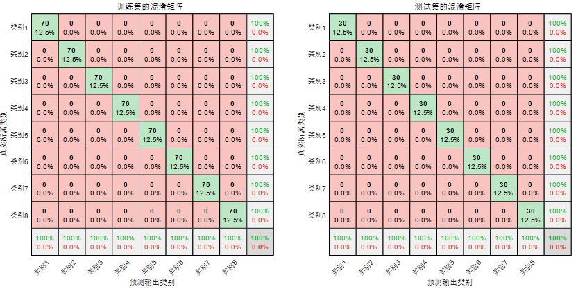
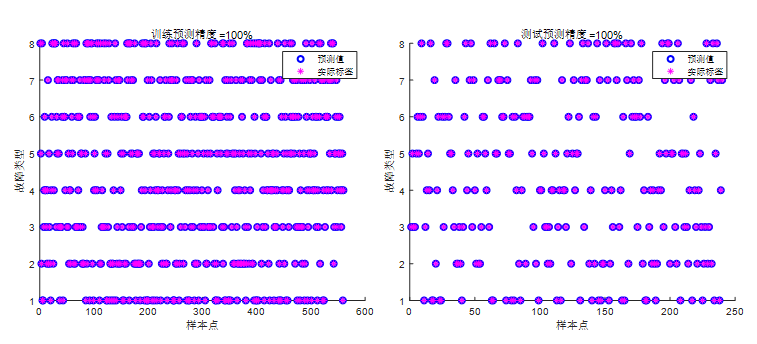

# Fault Identification: GASF-CNN, a fault identification/classification model based on Gram angle field (GASF) and Convolutional Neural Network (CNN).

Applicable Platform: Matlab 2021 version and above.
Content:
1. An Excel format fault dataset.
2. A time-series to image conversion program containing Gramian summing fields (GASF) and Gramian summing fields (GADF).
3. A resolution modification program (generates images with batch resolution modifications before entering into CNN models).
4. A CNN fault diagnosis program.

Applicable Fields: Suitable for various data classification scenarios, such as rolling bearing faults, transformer oil gas faults, power system transmission line fault areas, insulators, distribution networks, and disturbances in electric energy quality, etc., for recognition, diagnosis, and classification.
Input Data Format: (Each row represents a sample, the last column indicates the fault category label)
\n    GASF Image Generation:
\n    Identification Results: (Confusion matrix of training set and test set)
\n    Training Set and Test Set Scatter Plots:
\n    Training Curve: Accuracy and loss change graph

## Images

<!-- PAYMENT_BLOCK -->

## Get this dataset

- Payment link (Stripe): [Buy now](https://buy.stripe.com/3cs8yP7sY87d0vu9AB)
- Payment QR code: 

<!-- /PAYMENT_BLOCK -->
